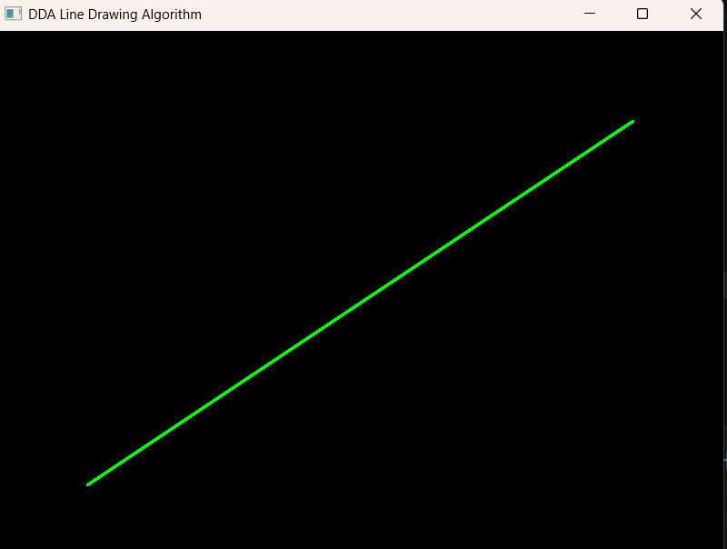
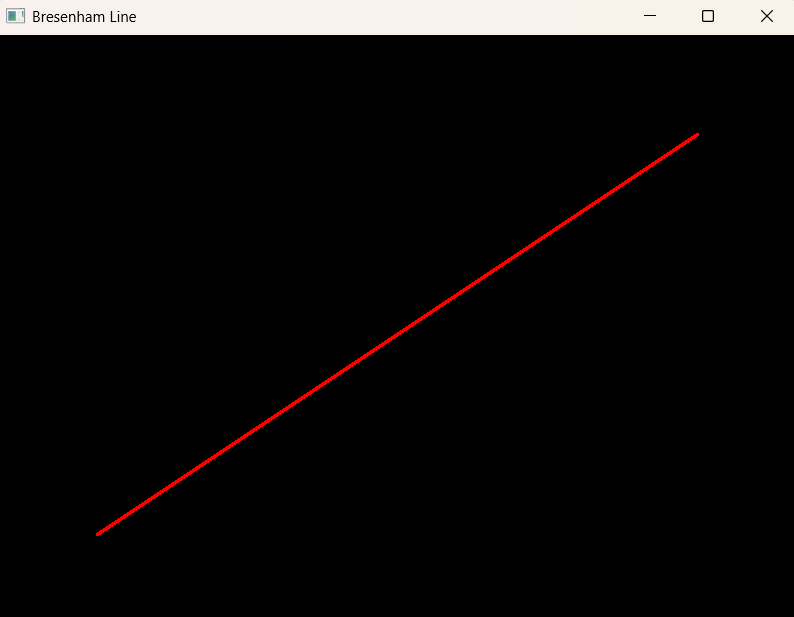
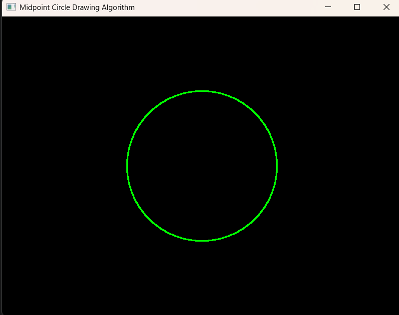
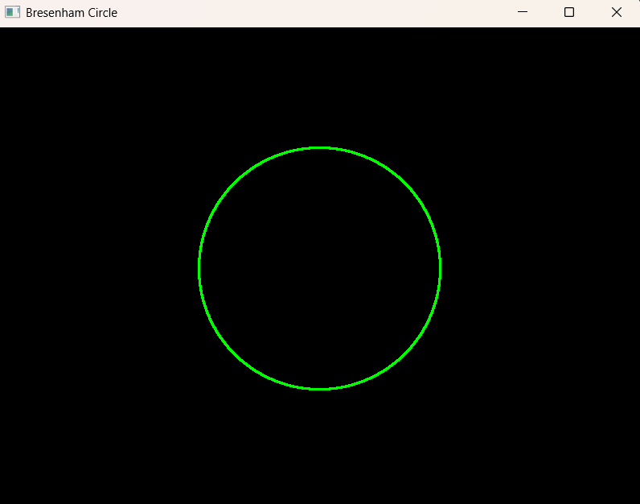
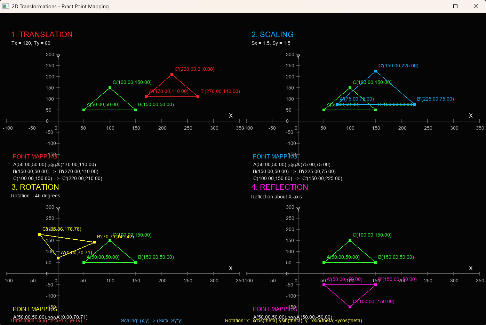
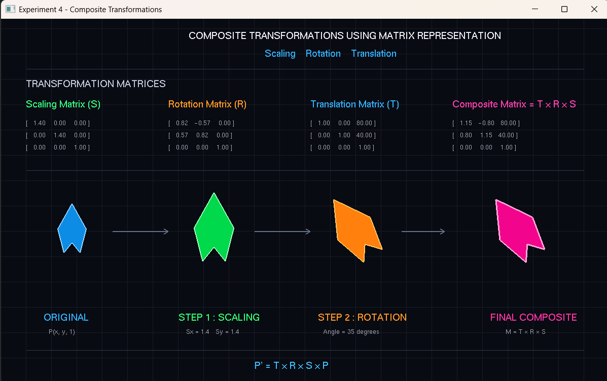
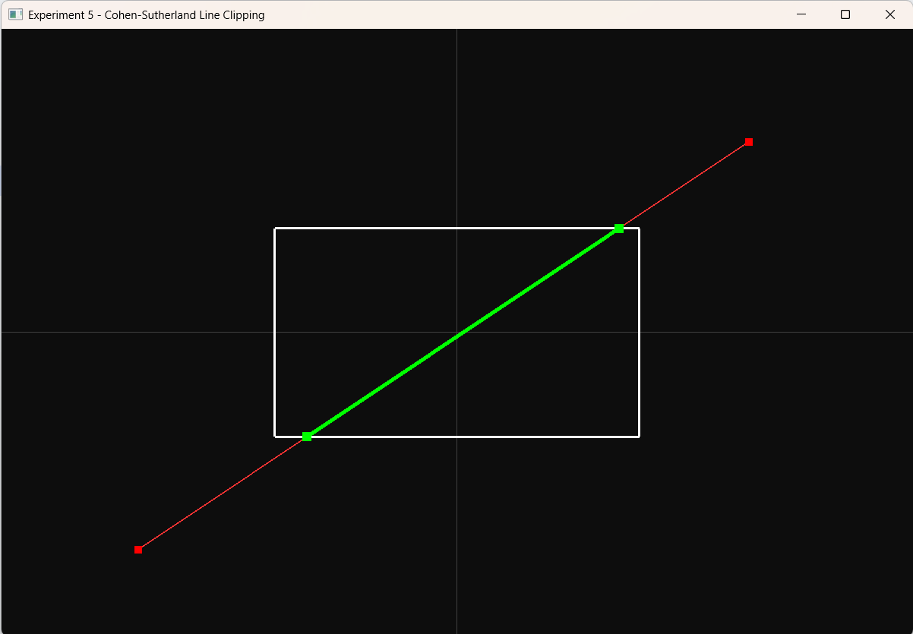
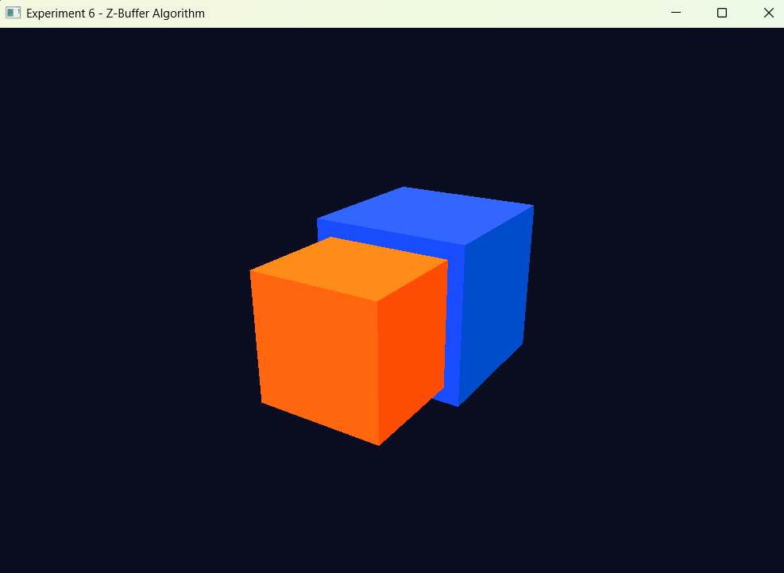
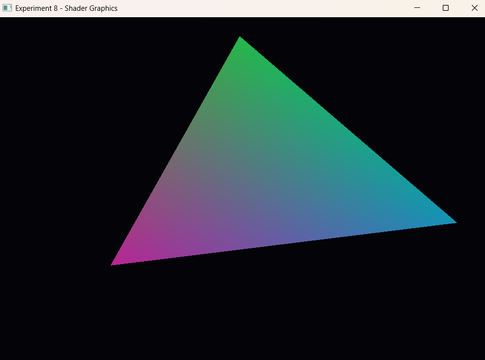

# Computer Graphics Lab Experiments 1–8

C++ implementations of core Computer Graphics lab experiments using OpenGL/GLUT. This repository includes source code and screenshots of program output.

## Experiments

| Experiment | Topic | Source file |
|---|---|---|
| 1 | DDA and Bresenham Line Drawing Algorithms | `Experiment_1_DDA_Bresenham.cpp` |
| 2 | Midpoint Circle Drawing Algorithm | `Experiment_2_Midpoint_Circle.cpp` |
| 3 | Two-Dimensional Transformations | `Experiment_3_2D_Transformations.cpp` |
| 4 | Composite Transformations | `Experiment_4_Composite_Transformations.cpp` |
| 5 | Cohen–Sutherland Line Clipping Algorithm | `Experiment_5_Cohen_Sutherland_Clipping.cpp` |
| 6 | Z-Buffer Hidden Surface Removal | `Experiment_6_Z_Buffer.cpp` |
| 7 | Phong Illumination Model | `Experiment_7_Phong_Illumination.cpp` |
| 8 | Vertex and Fragment Shaders | `Experiment_8_Vertex_Fragment_Shaders.cpp` |

## Output Screenshots

### Experiment 1 — DDA Line Drawing

### Experiment 1 — Bresenham Line Drawing

### Experiment 2 — Midpoint Circle Drawing

### Experiment 2 — Bresenham Circle Drawing

### Experiment 3 — 2D Transformations

### Experiment 4 — Composite Transformations

### Experiment 5 — Cohen–Sutherland Line Clipping

### Experiment 6 — Z-Buffer Hidden Surface Removal

### Experiment 8 — Vertex and Fragment Shaders

## Requirements

- A C++ compiler
- OpenGL
- GLUT or FreeGLUT
- GLEW for Experiment 8

The exact installation and compilation commands depend on your operating system and OpenGL setup.

## Repository Contents

- Eight `.cpp` source files, one for each experiment
- `images/` directory containing output screenshots

## Notes

- Screenshots are provided as visual output references.
- Experiment 7 uses the OpenGL fixed-function lighting pipeline to demonstrate illumination.
- Experiment 8 uses GLSL shaders and requires GLEW and FreeGLUT as noted in its source file.
